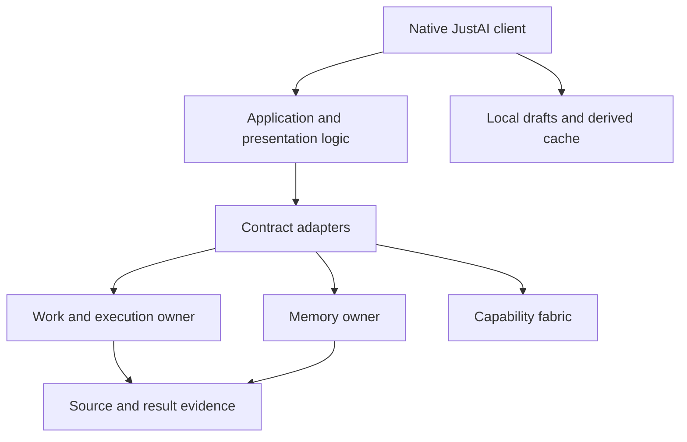

# JustAi Architecture

JustAi is a thin project-orchestration control plane around safe-mini, the substrate that makes mini-swe-agent's bash-action loop trustworthy on private repos.

The existing implementation and backend migration are described first. The [native workbench design draft](#native-workbench-design-draft) is a proposed successor product surface; its presence does not claim that native execution or the client has shipped. Historical v1.0.0 designs remain archived.

## Current Shape

```text
Orchestrator
============

Human / agent operator
        |
        v
JustAi control plane
  - classify intent
  - decompose goal into chunks
  - review plan quality
  - apply R0-R3 checkpoints
  - dispatch remaining executable work
  - synthesize results and memory
        |
        v
safe-mini substrate (separate repo; not yet wired here)
  - mini-style bash-action loop
  - worktree isolation
  - env scrubbing
  - command/path guard
  - observation policy
  - incident artifacts
  - trajectory + ledger
  - failure classifier
        |
        v
private benchmark / repo worktrees
```

The control plane should stay small enough to reason about. The substrate should stay small enough to audit in one sitting. The experiment driver should live outside both, because calibration work is not orchestration and not runtime substrate.

## Three Pillars

### 1. Scope

Scope lives in JustAi.

`justai.scope_planner` turns a goal into bounded tasks with success criteria, dependencies, risk labels, and target agent hints. `justai.reviewer` checks whether the plan is coherent. `justai.checkpoint` applies R0-R3 gates before anything is allowed to run.

The long-term job of this layer is to predict both budgets:

- move budget: how many bash actions a chunk should get
- observation budget: how much command output the agent should see per action

### 2. Substrate

Substrate lives in the separate safe-mini repository. JustAi does not yet import or invoke it.

The substrate is the load-bearing runtime around a mini-swe-agent-style loop:

- prompt -> one bash action -> observation -> repeat
- executor policies: open, safe, allowlist
- observation policies: full, tail, headtail, structured, structured plus raw tail
- worktree provisioner: copied repo, scoped HOME, sanitized PATH
- command/path guard: denylisted commands and sensitive paths
- incident artifact: full transcript saved for audit

JustAi should consume this as an imported dependency, not own it forever.

### 3. Guardrails And Classifier

Guardrails and failure classification also belong in safe-mini.

JustAi needs structured failure information from the runner so it can decide whether to re-scope, retry, escalate, or stop. That means the runtime should report failure class, trajectory, budget usage, and relevant incident artifacts in its `RunResult`.

## Three Repos

| Repo | Responsibility |
| --- | --- |
| `safe-mini` | Runtime foundation and public substrate API. |
| `JustAi` | Project orchestration, chunk sizing, checkpoints, dashboard, synthesis. |
| `local-resident` | Local experiment driver for private benchmark slices and calibration data. |

Planned dependency graph:

```text
JustAi -----------+
                  +--> safe-mini
local-resident ---+
```

Planned ship sequence:

- Phase A: consumers pin `safe-mini @ git+https://github.com/JustinJLeopard/safe-mini.git@...`.
- Phase B: safe-mini publishes to PyPI and consumers use a version pin.
- Current state: the safe-mini repo exists and has its own validation evidence, but JustAi has no pinned dependency or concrete runner integration. The local and delegated execution modes therefore fail closed.

## Current Repo Layout

The relevant Python package shape after the Phase 4 renames:

```text
justai/
  __init__.py
  __main__.py
  cli.py
  orchestrator.py
  scope_planner.py
  agent_dispatch.py
  checkpoint.py
  run_identity.py
  reviewer.py
  intent_gate.py
  synthesizer.py
  results.py
  memory.py
  trajectory.py
  ledger.py
  learning.py
  health.py
  tracing.py
  api.py
  auth.py
  discord.py
```

Important boundaries:

- `scope_planner.py` owns task decomposition and task data shapes for the current repo.
- `agent_dispatch.py` is transitional. Local, delegated, and swarm modes return explicit unavailable-backend errors; planner-authored success criteria are not executed as task completion. `escalate_plan` returns one result per planned task at its original position, so `depends_on` indices stay meaningful; a dependency that cannot name an earlier task fails the task closed instead of dispatching it. The standalone `AgentDispatchPipeline` experiment is quarantined and its `run` raises — it held generated code as strings and never materialized it, so its test run described the launching checkout rather than anything it produced.
- `checkpoint.py`, `reviewer.py`, and `intent_gate.py` are control-plane gates. A blocked task keeps its position in the plan and is passed to dispatch as blocked, rather than being filtered out.
- `run_identity.py` owns what tells one run from another. A run id is a UUID and is not derived from the session label, the clock, the process, or the goal — each of those collides between two runs started together — and it is never read from the environment, which would hand one run's identity to every later run in a long-lived interpreter such as the API server.
- An approval gate belongs to one run: `checkpoint.py` scopes it to a `GateIdentity` of run id plus plan index and stores it at `gates/<run_id>/plan-<index>.json`. Everything about that path is load-bearing. A record that contradicts its own location is read as no decision rather than as an approval; the old `gates/gate_<session_ref>-plan-<index>.json` layout is not consulted at all, in either direction; and cleanup takes a run id and nothing else, so a finished run cannot delete a concurrent run's pending approval. `session_ref` remains a human label for tracing and memory — it is reused on purpose, it is usually empty, and it scopes nothing.
- `results.py` owns the canonical status vocabulary and the single run verdict. `synthesizer.py` and `learning.py` both read it, so the run summary and the stored trajectory cannot disagree about what succeeded. Only a nonempty result set in which every task reported `done` is `complete`; an unrecognised status raises instead of falling through to a non-failure bucket.
- `exit_codes.py` documents the process exit codes. 0 means verified complete; an ambiguous goal exits `CLARIFICATION_REQUIRED`, and `justai status` exits `NOT_READY` on the same derivation the API reports as `all_ok`.
- `trajectory.py` and `ledger.py` are the local result/accounting surface until safe-mini owns the canonical types.
- `memory.py` is integration glue with the surrounding development memory system.

## Failure Taxonomy

safe-mini should report failure classes rather than a single generic failure state:

- `exhausted-ideas`
- `budget-exhausted`
- `context-starvation`
- `reward-hacking`
- `embodiment-failure`
- `safety-violation`
- `action-protocol-violation`

These classes come from the safe-mini substrate architecture memory. JustAi should use them to choose the next orchestration move. For example, budget exhaustion implies a different fix than a safety violation.

## Two Budgets

The architecture uses two budgets, not one:

| Budget | Meaning |
| --- | --- |
| Move budget | Maximum bash actions for a chunk. |
| Observation budget | Maximum command output kept visible per action. |

The lab evidence matters here: tiny observations can fail an otherwise solvable task even if the move budget is generous. Scope prediction must size both.

## Runtime Data Flow

Current transitional flow:

```text
justai run --auto --local "goal"
  -> run_identity.new_run_id            (unless --run-id resumes an existing one)
  -> checkpoint.own_run(run_id)         (refuses a run another process is driving)
     -> intent_gate.classify
     -> scope_planner.decompose
     -> reviewer.review_plan
     -> checkpoint.evaluate(task, GateIdentity(run_id, index))
     -> agent_dispatch.escalate_plan(mode="local", blocked_indices=<checkpoint blocks>)
     -> explicit unavailable-backend results
     -> synthesizer.synthesize(status="failed")
     -> trajectory / ledger / memory best-effort writes
     -> checkpoint.cleanup_run(run_id, owner)   (terminal, inside the claim)
     -> checkpoint.sweep_gate_dirs() / prune_abandoned_runs()
  -> exit_codes.for_run_status("failed") -> exit 1
```

No execution mode is a live backend right now. Local mode stays exposed only as a transitional compatibility surface and fails closed until exact-pinned safe-mini execution plus goal-bound artifact acceptance are integrated.

## Current Boundary

The live architectural boundary is the control-plane / substrate split:

- JustAi owns project orchestration, chunk sizing, checkpoints, dashboards, and synthesis.
- safe-mini owns the bash-action runner, executor policy, observation policy, worktree isolation, guards, incident artifacts, trajectory recording, ledger, and failure classifier.
- local-resident owns the private benchmark and calibration loop that proves whether the orchestration layer adds value.

Historical sprint-era designs now live under `docs/archive/` when they are still useful as evidence. They are not current product contracts.

## Migration Plan

When JustAi integrates safe-mini, remove or replace the remaining local placeholders and bind these pieces to the substrate's public API:

- runner loop and action protocol
- executor policy types
- observation policy types
- worktree provisioner
- command/path guard
- incident artifact writer
- failure classifier
- trajectory recorder
- run ledger
- canonical `Chunk`, `Budget`, `RunResult`, `FailureClass`, `ObservationPolicy`, and `ExecutorPolicy` types
- `AgentRunner` Protocol/ABC

TBD post-JustAi-closure:

- whether JustAi keeps a temporary local Protocol stub in Chunk F
- exact split between JustAi's current `trajectory.py`/`ledger.py` and safe-mini's canonical versions
- whether safe-mini ships benchmark fixtures or leaves all benchmark data to local-resident

## Design Rules

- Keep JustAi honest about what exists today.
- Do not reintroduce removed backends as documentation promises.
- Keep safe-mini generic; it should not know JustAi-specific dashboards, Discord, auth, or learning aggregation.
- Keep local-resident focused on experiment generation and calibration, not orchestration.

## Native workbench design draft

This section specifies the proposed native client and its integration boundaries. It does not describe delivered native code or change the current Python control-plane behavior above. Product requirements and design questions live in [Product](PRODUCT.md); progress and acceptance live in [Delivery](DELIVERY.md). The earlier safe-mini integration plan describes that specific existing backend path, not a requirement that every future native provider run through it.

### Components and state ownership



The client owns view state and drafts. An application layer composes approved operations through adapters. Each durable work item, effect, permission and accepted Memory record has an identified owner. Closing a client connection does not stop independently owned execution.

| Concern | Authoritative home | JustAI behavior |
| --- | --- | --- |
| Team identity, operating policy and resource configuration | Operator's maintained identity/policy/deployment sources | Read the authorized profile and effective grants. A display, snapshot or name does not grant authority. |
| Execution and sessions | Selected native runtime and its supported integration | Request supported operations and read their acknowledged state; retain provider/session attribution. |
| Work lifecycle and external effects | The selected work/effect owner for that item | Present status and submit commands to that owner. Do not create a competing settlement journal. |
| Memory semantics and accepted records | Existing Memory product and its designated writer | Retrieve, cite and propose corrections/learning through its contract; display its disposition. |
| Capability discovery and composition | Existing capability fabric at its delivered scope | Discover and invoke advertised capabilities. MCP is an interface, not the Memory store or permission owner. |
| UI, interaction rules and product-specific additions | JustAI repository | Specify, implement and verify those additions here. |
| Reusable infrastructure introduced during product work | An existing suitable component, or an explicitly maintained new component | Consume one versioned implementation after extraction and migration. |

The authority table defines responsibilities, not a new service or wire schema. Resolve concrete source locations, maintainer and supported revision when binding each deployment. Private operational bindings remain private. Public examples use synthetic identities and explicit configuration.

### Stack and target decisions

The primary client direction is Rust. [GPUI Kit](https://gpui-kit.com/docs/) is the leading renderer candidate; compare the representative workbench workload with [nanoui](https://github.com/justrach/nanoui) and retain [Slint](https://slint.dev/) as an alternative. nanoui is Zig; selecting it would require a deliberate UI-language or Rust/Zig integration decision. Selection remains open until M2 qualification. Pin the chosen dependency/toolchain revisions and check distribution terms at that decision.

Share presentation-independent Rust code for protocol adaptation, event reduction, source references and interaction rules where it actually remains portable. Rendering, process/filesystem access, key storage, notifications and transport stay behind target-specific adapters. Tokio or an HTTP service is selected where the real integration needs it, not added to every client by default.

The existing React/TypeScript/Vite dashboard remains the current implementation and visual evidence; it is not the selected production native renderer. Browser/WASM and ChatGPT plugin clients require their own support checks. A shared language or compiled WASM artifact does not establish platform parity.

### Integration contracts to bind in M1

For each real integration, record these details beside its adapter/configuration and tests, using the provider's existing schema wherever one exists:

- The owning component and maintaining role; source/package version; supported protocol and feature set.
- Work, session, principal and operation identity mapping. Keep these identities distinct.
- Snapshot/event consistency, ordering, reconnect cursor and duplicate handling; freshness and unavailable states.
- Command acknowledgement, authorization at execution, cancellation semantics, deadlines and idempotency or reconciliation support.
- Persistence and recovery responsibility; permitted cache/draft data; account isolation and retention/deletion behavior.
- Evidence references, error vocabulary and one representative consumer contract check.

If a provider cannot supply a needed guarantee, expose that gap and qualify an adapter or owner-side change. Do not relabel a local optimistic event as confirmed remote state. Define a new contract only for a real uncovered behavior, with a maintaining owner and consumers.

### References, copies and new behavior

| Relationship | Meaning | Required provenance and update path |
| --- | --- | --- |
| Reference | A capability or decision owned elsewhere | Owner and authoritative source/contract. Change the owning source. |
| Derived view or copy | Rendered status, cache, summary, fixture or public projection | Source, revision or observation time, transformation and freshness; label it as derived. Regenerate/update the view after source review. |
| JustAI addition | Newly specified product behavior | Mark it as new, state its purpose and keep its contract here. It does not silently become team policy. |
| Reusable addition | New behavior useful to other tools or the team | Name the proposed owning component and adoption state. Transfer the maintained implementation and use it as a dependency. |

One authority means one accepted owner for each fact and contract. It permits separate databases, replicas, caches, deployments and clients with explicit responsibilities. A read model may be useful without becoming another accepted-record store.

The private operator profile may follow evolving team practice. Public product defaults are deliberately selected and versioned; they do not automatically absorb private habits, experiments or environment-specific exceptions.

### Change flow and extraction

When an upstream source changes, inspect the relevant delta, assess the consumer contract, update pins/mappings and verify affected behavior. Show the consumed revision and stale/unsupported state where it affects a user's decision. Integrate this with existing repository checks and release work; a new synchronization controller is not implied.

A reusable improvement first goes to an existing suitable owner. If it needs its own contract, maintainer and release lifecycle, establish a local source checkout, upstream repository, license, tests and release/install path. A maintaining seat is responsibility, not a requirement for an always-running new agent.

Move or package the implementation with attributable history where practical. Change JustAI and the other intended consumer to import or call it; retire duplicate implementations or document their bounded migration. Verify useful use by the owner and consumers. A second repository containing a copy is not a completed extraction.

Examples:

- Navigation and a work-detail view remain JustAI product code.
- A Memory correction capability belongs with the Memory contract and writer; JustAI owns the editor interaction.
- General effect reconciliation belongs with the selected execution/effect owner, if that owner already covers it.
- A reusable native component library may become a separate package/repository when other consumers and independent releases justify it.

Private operator details must not enter public source as extraction metadata. Publish only the implementation/contracts and evidence that their owners have designated shareable.
